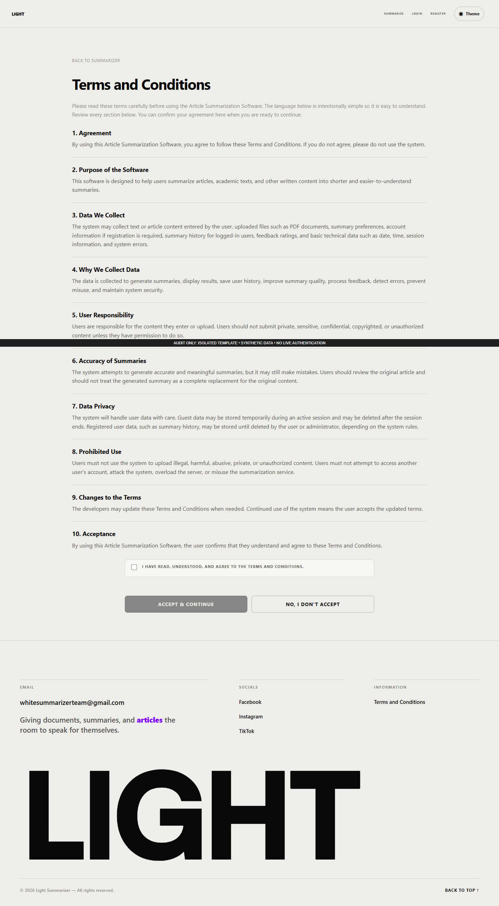
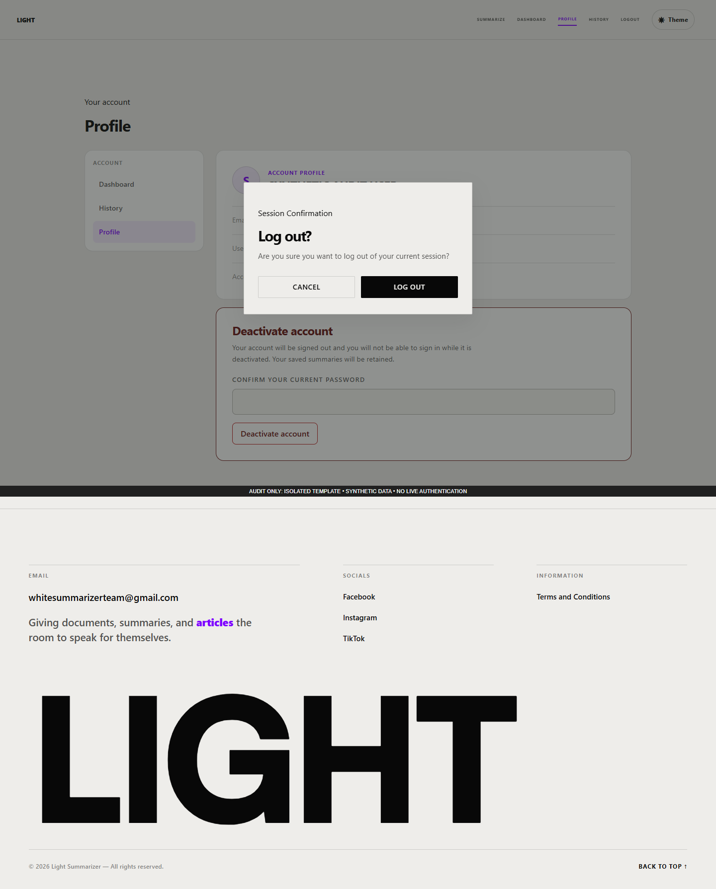

# Appendix F — User Manual

This manual describes LIGHT, the document summarization application found in the audited source. It distinguishes guest, registered-account, administrator, and assigned-reviewer access. The instructions describe implemented controls; successful submission, authentication, email delivery, worker operation, and data persistence still require an approved end-to-end demonstration.

**Screenshot evidence limitation.** Every screenshot in this appendix was captured from the original application templates in an isolated browser renderer on 17 October 2026. Anonymous or synthetic account sessions and empty/synthetic records were supplied to avoid altering the existing application database. A black provenance banner identifies that condition. The displayed account, summary, zero counters, and empty lists are examples, not actual usage or research results. External fonts and service requests were blocked. These screenshots explain the interface; they do not prove a working deployment or successful authentication. Capture URLs, desktop/mobile versions, and exact checks appear in `screenshots/README.md` and `../system-audit/browser-readonly-results.json`.

Table 53. Available access contexts and interface boundaries.

| Access context | Available interface |
|---|---|
| Guest | Public information and account forms, summary workspace, accessible results, and permitted result actions. Nutshell, history, and analytics direct guests toward registration. |
| Registered account | Summary workspace, Nutshell, dashboard, own history/analytics, profile, and accessible results. An active account is required for assigned reviews. |
| Administrator | Administrative console, system-wide analytics, user-management actions, audit logs, and protected diagnostics/exports. Administrators can also use summary-related interfaces. |
| Assigned reviewer | An active account receives access to its assigned blinded summary reviews. Assignment access is separate from merely having an account. |

Table 53 presents available access contexts and interface boundaries. The stated status and qualifications govern its interpretation.

## A. Landing Page and Shared Navigation

Figure 53. LIGHT landing page rendered from source with an anonymous fixture.

The landing page introduces the application's purpose and leads to the document workspace. Figure 53 shows its shared navigation and information sections. Select **Summarize** to open the workspace. Select **Login** or **Register** to access account forms. The About LIGHT section explains the intended purpose; the older About address redirects to that section. Signed-in administrator visits to the landing route lead to the summarizer.

1. Open the application address supplied by the operator.
2. Read the landing information and select **Summarize** or the start link.
3. On a narrow screen, select the menu button to reveal navigation. Select a link or press **Escape** to close it.
4. Use the footer **Terms and Conditions** link to read the conditions. **Back to top** returns to the beginning of the current page.

The footer email link opens the reader's email application. It does not itself submit a support request. The social links currently open general Facebook, Instagram, and TikTok homepages; the audit did not verify project-specific social accounts. The shared theme control appears on supported nonlanding pages. Theme preferences are stored in that browser. Mobile menu opening and Escape closure were verified in isolation; external links were not opened.

## B. Sign In and Administrator Verification

Figure 54. Sign-in form rendered with an anonymous fixture.

Figure 54 shows the ordinary account form. Enter a username or email and the account password, then select **Sign In**. The password visibility button changes masking on screen. The regular sign-in form offers **Keep me signed in for 30 days**; use that option only where retaining the account session is appropriate. **Forgot password?** and **Reset password** lead to recovery. **Create Account** opens registration.

Figure 55. Conditional administrator email-code screen using a synthetic pending-login fixture.

For the administrator login flow, the application can replace the credential form with the code screen in Figure 55. Enter the six-digit code sent to the displayed masked/hinted address and select **Verify code**. The interface states that codes expire after ten minutes and can be used once. **Return to sign in** cancels the pending code step. The old administrator challenge setup/change addresses are compatibility redirects and do not present an active challenge-configuration screen.

Empty fields, invalid credentials, expired codes, inactive accounts, and request failures can prevent access. Follow the displayed message and retry the appropriate step. No actual login or email verification was performed during this documentation audit. Password visibility was tested only with synthetic text. Its current visibility buttons are excluded from ordinary Tab navigation; this is recorded as an accessibility issue.

## C. Create Account

Figure 56. Registration form rendered without submitting account data.

The registration form in Figure 56 collects a preferred username, email address, password, password confirmation, and acceptance of the terms.

1. Select **Create Account** or **Register**.
2. Enter the username and email address. The interface requests a username of at least three characters.
3. Enter a password and repeat it in **Confirm Password**.
4. Read the linked **Terms and Conditions**, then select the agreement checkbox if accepting them.
5. Select **Create Account** and follow the response.

The server password policy checks a length of 8–72 bytes, at least one number, and at least one uppercase letter or special character. For ordinary ASCII passwords this corresponds to 8–72 characters; multibyte characters consume more than one byte. Strength and match hints provide immediate feedback, while the server makes the final validation decision. The eye buttons can show or hide each password field.

No account was created during the audit. The form's mention of “custom summarization profiles” should not be interpreted as an editable saved-profile screen: the discovered dashboard can infer preferred settings from past summaries, and the Profile page displays account details and deactivation.

## D. Recover Password

Figure 57. Password-recovery form rendered without sending an email.

Use Figure 57's form when the account password is forgotten. Enter the account email and select **Send OTP**. Follow the recovery response and use the received verification code in the reset form. **Return to Login** and **Create Account** provide alternative navigation. A success-style response alone should not be treated as proof that an email has arrived; inspect the actual inbox and the application's message. Delivery and recovery outcomes were not exercised during the audit.

## E. Set a New Password

Figure 58. Password-reset form rendered with no recovery request in progress.

The reset page in Figure 58 asks for the email address, security code, new password, and confirmation. Email may already be filled when the application has a recovery session.

1. Enter or check the email address used for recovery.
2. Enter the code from the recovery email.
3. Enter a new password that meets the policy and repeat it exactly.
4. Use the visibility and strength hints as needed, then submit the reset form.
5. Follow the success/error message and return to sign in when the change succeeds.

An invalid, expired, or already-used code and mismatched or weak passwords can prevent completion. Request a new code through recovery when the displayed response requires it. No account password was changed during the audit.

## F. Terms and Conditions

Figure 59. Public terms page rendered with an anonymous fixture.

Figure 60. Pending-acceptance page using a synthetic registered-account fixture.

The application contains a public terms page and an acceptance page. Figure 59 shows the public version; Figure 60 shows the acceptance controls that appear for an account awaiting confirmation. The footer's acceptance-page link allows guests to read the content, but that page does not show its account-confirmation form to guests.

1. Read the terms sections before agreeing.
2. Where the agreement form appears, select the acceptance checkbox.
3. Select **Accept & Continue** to submit agreement and follow the resulting destination.
4. If declining, select **No, I Don't Accept**. The current displayed control shows a message and returns to the landing page after a short delay.

The checkbox enabling the acceptance button was verified locally. Agreement was not saved. The visible decline button does not submit the server's separate decline action, so the manual does not claim that clicking it signs the user out or deletes acceptance state. That mismatch is an audit finding.

## G. Summarizer Workspace

Figure 61. Summary workspace showing source selection and generation settings.

Figure 61 contains the source and settings needed for a summary. The workspace is accessible to guests and registered accounts. Provide only documents or text that may be processed under the applicable usage conditions.

### G.1. Select the source

1. Optionally enter **Document Title**. Leaving it blank allows the application to use a document heading or derived title.
2. Optionally enter **Focus / Topic / Question** to request emphasis on a subject. The visible field limits input to 300 characters. This focuses the summary; it is not a promise that a question will be answered correctly.
3. Choose exactly one source method:

Table 54. Source methods and user actions.

| Source method | User action | Restriction or recovery |
|---|---|---|
| Upload File | Browse for or drag a PDF/DOCX into the upload area. Use **Replace** or **Remove** to change the selected file. | Read the maximum size printed on the actual running page. Its value depends on configuration and PHP upload limits. The main form selects one file. |
| Paste Text | Paste readable document text into the text area. | Stay within the byte limit shown by the running page. Blank or unreadable text is rejected. |
| URL | Paste a complete public HTTP or HTTPS article address. | Invalid URLs or inaccessible/unreadable sources can fail. URLs with embedded credentials are rejected by the browser validation. |

Table 54 presents source methods and user actions. The stated status and qualifications govern its interpretation.

The isolated screenshot's upload limit belongs to the audit PHP environment and must not be treated as the deployment's configured limit. Choosing text/URL and rejecting an empty URL were tested locally. No live website document upload, article retrieval, or extraction workflow was performed.

### G.2. Choose settings and submit

Table 55. Summary settings in the main interface.

| Setting | Available controls |
|---|---|
| Output Format | Paragraph; Bullet Points; Hybrid (Overview + Bullets); Structured Sections; Key Takeaways. |
| Analysis Mode | General; Academic; Executive; Technical; Study; News; Legal & Policy; Scientific. |
| Summary Depth | Very Brief; Brief; Short; Balanced; Detailed; Comprehensive. |

Table 55 presents summary settings in the main interface. The stated status and qualifications govern its interpretation.

Select the desired format, mode, and depth, reading the explanation shown beside each setting. Then select **Summarize Document**. A successful initial request leads to processing or an existing completed result; an unsuccessful request presents an explanation and recovery instruction. Setting changes were verified in isolation. A completed saved website summary was not generated during the audit; isolated Python generation is reported separately.

If the operator has configured the optional **Generation Method** section, the form may offer evidence-controlled AI synthesis. Read its notice before opting in: selected source passages may be sent to a configured language-model endpoint, including an external endpoint. The interface explains that automated checks are heuristic and that structured sections remain extractive. This conditional control was source-inspected and was not enabled in the isolated renderer.

### G.3. Errors, drafts, and Nutshell

Correct the field named in an error. The empty-URL check, for example, asks the reader to provide the complete HTTP(S) address. Recovery controls may offer retry, a different source method, or sign-in, depending on the error. A file must be selected again after recovery because browsers cannot restore its bytes. The source and settings can be retained within the browser tab for up to one hour; close or clear a shared browser session as appropriate after handling sensitive source material.

**Generate Nutshell** requests a concise rendition in a separate panel. Guests are redirected to registration; that navigation was verified. Registered users prepare a source, select **Generate Nutshell**, then read the panel's output, not-needed notice, or recovery error. **Copy** appears after a successful output. The current Nutshell endpoint supports six analysis labels and normalizes legal/scientific selections to general; users should not assume that all eight main-summary modes are preserved in Nutshell. No Nutshell was generated in the audit.

## H. Processing and Recovery

Figure 62. Processing layout using a synthetic pending request; execution was blocked.

The processing screen displays the document/source and selected format, mode, and depth. Figure 62 is a layout example only. Normally the page starts execution, checks status, and opens the result when complete. It is not a percentage-complete guarantee.

1. Wait for the displayed status after submitting a source.
2. If the page reports a connection interruption, use **Check connection and status** where offered. This distinguishes checking an existing request from intentionally starting another request.
3. If a recoverable processing failure offers **Retry summary**, review the message and retry as directed.
4. Use the cancel control when available to cancel the current request and return to settings.
5. If returning to a file source, choose the file again.

Opening the processing address without a pending request redirects to the workspace. Cancellation and retry may be unavailable for settled or ineligible jobs. Automatic execution and status requests were blocked in the screenshot harness, so no successful job, cancellation, or retry is claimed.

## I. Summary Result, Source Review, and Export

Figure 63. Result interface with explicitly synthetic summary text, not model output.

The result page in Figure 63 presents the primary summary and available supporting information. Access depends on the account/guest ownership context or an authorized share token. Saved output may also contain key takeaways, conclusion, section analysis, keywords, supporting passages, coverage, and summary details. Sections appear only when corresponding data exists.

1. Read the main summary and check the document title.
2. Use **Check source**, source disclosures, and numbered evidence links where available to compare claims with the original text.
3. Expand relevant details to understand the source and settings.
4. Use the toolbar actions described below as needed.

Table 56. Result toolbar actions and verification limits.

| Action | Procedure and expected behavior | Verification limit |
|---|---|---|
| Copy Summary | Select the copy control, then paste into the intended destination. If browser copying fails, select and copy manually. | Exact synthetic text copied successfully with browser permission. |
| PDF | Select the PDF control, review the browser print preview, then print or choose Save as PDF if available. | This uses the browser print dialog; a server PDF download is not implemented by this button. Printing was not exercised. |
| Text | Select text export and save the .txt download. | Synthetic TXT export was saved and its exact content checked. |
| Listen | Select the audio control and use the player after speech generation succeeds. | Depends on the audio worker; no audio was generated or played in the audit. |
| Translate | Request the displayed Filipino translation and compare it with the original summary. | Depends on the translation worker; no translation was requested. |
| Theme | Select the theme control to switch between light and dark reading styles. | Switching the synthetic result to dark mode was verified. |
| Back | Use the return control to open summary settings. | It does not by itself create or delete a summary. |

Table 56 presents result toolbar actions and verification limits. The stated status and qualifications govern its interpretation.

Model output and automated evidence checks require human judgment. The available summary-quality evidence in this audit does not establish correctness for every source or mode. The code can display multi-document metadata, but the main source form exposes one file and no multi-file selection workflow.

## J. Summary Feedback

The feedback area on the result page asks **Was this summary useful?** Its rating and comment actions are separate from a research survey or assigned blinded review.

1. Select one to five stars.
2. For a low/neutral rating, optionally select the improvement reasons that appear.
3. Optionally enter a comment of up to 500 characters in the visible form.
4. Select **Submit feedback** and wait for confirmation or an error.
5. If feedback already exists, select **Update feedback**, revise it, and submit again.

Selecting a low rating revealed the optional reason choices in the isolated test. No rating or comment was submitted. The interface describes feedback as anonymous, but the implementation associates feedback with account or guest identifiers for access and update behavior; anonymous display does not mean that no internal linkage exists. Expired sessions, access restrictions, rate limits, and validation can prevent saving.

## K. Unavailable Result

Figure 64. Unavailable-result state produced with a missing synthetic record.

Figure 64 shows the recovery view used when a requested result is unavailable or access cannot be granted. Follow **Back to summary settings** or obtain a valid authorized result link. Avoid assuming that another user's numeric result identifier grants access. Opening the result route without an identifier returns to the landing page. The missing-record view was checked in isolation; no real private result was requested.

## L. Personal Dashboard

Figure 65. Personal dashboard with an empty synthetic registered-account fixture.

The personal dashboard provides recent summary links, activity information, and a starting point for new summaries. Figure 65 uses empty data. Registered nonadministrators use this dashboard; administrators are redirected to the administrative console.

1. Sign in and open **Dashboard**.
2. Select a recent result or begin another summary.
3. If preferred settings are available, use their link to preselect the inferred mode, format, and depth, then review them in the workspace.
4. Use the analytics card's range controls and its **Open full analytics dashboard** link to inspect available activity information.

Preferred settings are inferred from prior saved summaries. This is distinct from editing or naming a saved custom profile. Empty accounts may have no recent summaries or inferred preference. The capture does not establish any real usage counts.

## M. Summary History

Figure 66. History page with no synthetic saved summaries.

Open **History** to view saved summary previews. Select a document title or **Access Full Report** to reopen an accessible result. When completed Nutshell records exist, **Nutshell History** presents their text and any linked main result. Figure 66 illustrates the empty state.

Guests are redirected to registration. The page shows up to 10 main summaries per page and up to 20 completed Nutshell records by default. It does not expose summary editing, renaming, or deletion controls. Although the backend accepts a page number, the current template has no Previous/Next navigation; access to older records through ordinary UI navigation is a documented limitation. The service's maximum accepted page size of 50 does not change the page's default of 10 main summaries.

## N. Analytics

Figure 67. Analytics page displaying the synthetic empty-data state.

Analytics describes saved summarization activity. Registered users see personal scope; administrators can see system-wide scope. Figure 67 contains no operational data.

1. Open the full analytics page from the dashboard card, or use the administrator Analytics link.
2. Select **Last 7 days**, **Last 30 days**, **Last 3 months**, or **This year**.
3. For a custom period, set **From** and **To** and choose **Apply filter**.
4. Review available completed summaries, processed documents/words, average reduction, usage distributions, processing durations, and recent activity.

Populated data can enable charts for summaries and Nutshell over time, style/depth use, word comparison, and source types. An empty-data message means that no qualifying records were supplied for the view. An unavailable/error message must not be interpreted as a measured zero. Populated charts and real-date filtering were not tested against existing records.

## O. Profile and Account Deactivation

Figure 68. Profile page displaying a reserved synthetic account identity.

The profile page in Figure 68 displays username, email, and join date. The sidebar returns to the appropriate dashboard or History. The discovered interface does not include editing the username/email, uploading a profile picture, or directly changing a password.

For deliberate account deactivation, read the explanation, enter the current password, and select **Deactivate account**. The interface states that the account will be signed out, cannot sign in while inactive, and retains saved summaries. Backend protections apply, including administrator-related restrictions. Deactivation is not permanent data deletion. No account was deactivated during the audit.

## P. Logout Confirmation

Figure 69. Logout confirmation opened from a synthetic signed-in profile.

Select **Logout** to open Figure 69's confirmation. Choose **Cancel**, click the backdrop, or press **Escape** to remain on the page. Choose **Log out** only when ready to leave the current session. The modal implements keyboard focus movement and returns focus when closed. Escape closure was verified on desktop and mobile; actual logout was not executed.

## Q. Administrative Console

Figure 70. Administrative console rendered with synthetic administrator access and empty records.

Figure 70 shows the administrative interface without exposing real accounts, feedback, or analytics. The normal application requires an authenticated administrator. The synthetic role used for this image does not prove that requirement has been tested live.

### Q.1. Review system information

Use **Statistics Period** and **Apply period** to select the overview interval. Review the system cards, analytics graph card, and storage counters. The shared graph card has 30d, 7d, 90d, and All controls and a link to full analytics. Storage cards display upload size and file count. Cleanup and delete-file actions exist in the dispatcher, but no visible maintenance button for those actions was found; this manual does not provide an invented button workflow.

### Q.2. Manage users

1. In **User Management**, search by the supported name/email/id text.
2. Filter by **Role** or **Status**, or choose **Clear filters** to reset the list.
3. Check the intended row and account identity carefully.
4. When an eligible row provides **Deactivate**, read its confirmation before disabling the account.
5. When an eligible row provides deletion, read the permanent-deletion warning before confirming. Deletion is different from deactivation and may remove associated records.

The current visible rows provide deactivation and deletion where permitted; the presence of other server dispatcher actions does not establish additional visible buttons. No real user row was loaded and no administration action was executed. Follow the approved operational authorization and backup procedure before changing accounts.

### Q.3. Review feedback and landing telemetry

Inspect **Summarizer Quality Telemetry** for available mode/depth/reason aggregates. Filter the feedback repository by rating, whether a comment exists, and sort order, then select **Filter**. **Reset** clears the filter. Result-title links open the referenced result where access allows. A separate comments repository displays submitted feedback comments.

The **Landing Page Analytics** section can show sessions, CTA conversion, dwell time, median LCP, bounce rate, device breakdown, scroll depth, daily trend, and referrer information. Respect the period printed on each panel; not every landing metric shares the overview's selected interval. Missing or unavailable measurements require investigation. These telemetry values are not survey responses or evidence of improved learning. The displayed zero values in Figure 70 are synthetic.

## R. Administrator Audit Logs

Figure 71. Audit-log viewer with a synthetic existing table and no log rows.

Select **Audit Logs** from the administrative console. Figure 71 shows filters for action, administrator identifier, and date range. Select **Filter** to apply them or **Clear** to reset them. When multiple pages exist, use **Previous** and **Next**; the current page indicator identifies the position. **Back to Dashboard** returns to the console.

Available rows show timestamp, administrator, action, request metadata, and details. Treat these records as administrative information. A missing-table message is distinct from a valid empty result; another isolated capture records the missing-table branch. The current filter controls lack explicit accessible labels and require remediation. No actual administrator activity record was read.

## S. Assigned Independent Reviews

Figure 72. Assigned-review page with an active synthetic account and no assignments.

The review page allows an active account to assess assigned summaries independently. Figure 72 shows the empty state, which instructs the reader to await assignments. Anonymous access produces a sign-in-required response. Merely signing in does not supply a review assignment.

When an assignment is available:

1. Open its **Review summary** link while using the assigned account.
2. Read the source document and blinded summary together.
3. Rate relevance, factual consistency, coverage, coherence, readability/fluency, conciseness, and non-redundancy separately.
4. Use the displayed five-level rubric: Very poor, Poor, Acceptable, Good, and Excellent.
5. Optionally add specific comments, then select **Submit assessment**.

The interface explains that submission locks the assessment and that corrections require the research administrator. Submitted items are marked accordingly. No assignment, score, or comment was created in the audit. This content-quality review instrument is separate from the capstone's proposed system-quality questionnaires and cannot substitute for actual IT-consultant or end-user responses.

## T. Evaluation Reports, Compatibility Routes, and Diagnostics

The code contains an administrator-protected evaluation export endpoint for an existing run in JSON, CSV, or HTML format. Its report template presents dataset/run context, metric availability, system/mode comparisons, human-rating coverage, agreement, paired comparisons, error classifications, challenge measurements, and limitations. Unavailable measurements are explicitly distinct from measured zero values. No existing run was exported or represented as a completed research evaluation in this audit; a live report screenshot is **UNAVAILABLE EVIDENCE**.

The current `evaluation.php` route redirects administrators to the administrative console. Older tabs and links that target that route's dataset/run/assignment/output views therefore do not provide a working management screen. The associated source partial includes controls for content-unit verification, error classification, and audited rating correction, but its presence is not proof of an accessible current UI. The operator must resolve the route/navigation gap before those procedures can be documented as an operational browser workflow. Obtain run identifiers and assignment links through the project's supported research administration process; no such complete UI process was verified here.

The database-health and feedback-feed addresses are administrator diagnostics returning JSON. The public health address returns a static service status and cannot establish database or model-worker readiness. Document Q&A and document/multi-document operations exist as API companions; the current normal result and source forms do not expose a chat widget or multi-file selector. Those API interfaces belong in the technical integration documentation rather than being presented as buttons a new user can find.

## U. Common Recovery Guidance and Evidence Trace

Table 57. Common recovery situations and user guidance.

| Situation | User guidance |
|---|---|
| Source validation message | Correct the named field, check file type/size or use a complete URL, and follow the offered recovery action. |
| Source is unreadable | Try permitted readable text or another supported document; the audit does not claim OCR for image-only files. |
| Connection interrupted during processing | Check the existing request/status using the provided recovery option before intentionally submitting another job. |
| File draft recovered | Select the local file again; the browser does not restore previously selected file bytes. |
| Result unavailable | Return to settings or obtain an authorized result link. |
| History/analytics asks for registration | Create or sign in to an active account before using registered-only features. |
| Audio or translation unavailable | Read the displayed message and retry only as directed; the service may require operator attention. |
| Review assignment unavailable | Use the correct account and supplied assignment link; contact the research administrator for assignment or correction needs. |
| Terms or sign-in interrupts navigation | Complete the requested prerequisite and continue through the permitted destination. |

Table 57 presents common recovery situations and user guidance. The stated status and qualifications govern its interpretation.

This manual derives its page actions and restrictions from `../system-audit/ui-feature-notes.json` (UI-001–UI-051), `../system-audit/ui-route-inventory.json`, and the source references they contain. Browser evidence supports only the identified isolated visual and local-interaction checks. The source files for the application were not modified. Desktop and mobile images for each captured state remain available in the screenshot register, including recovery, access-denial, and empty-state variants omitted from the main flow of this appendix.
