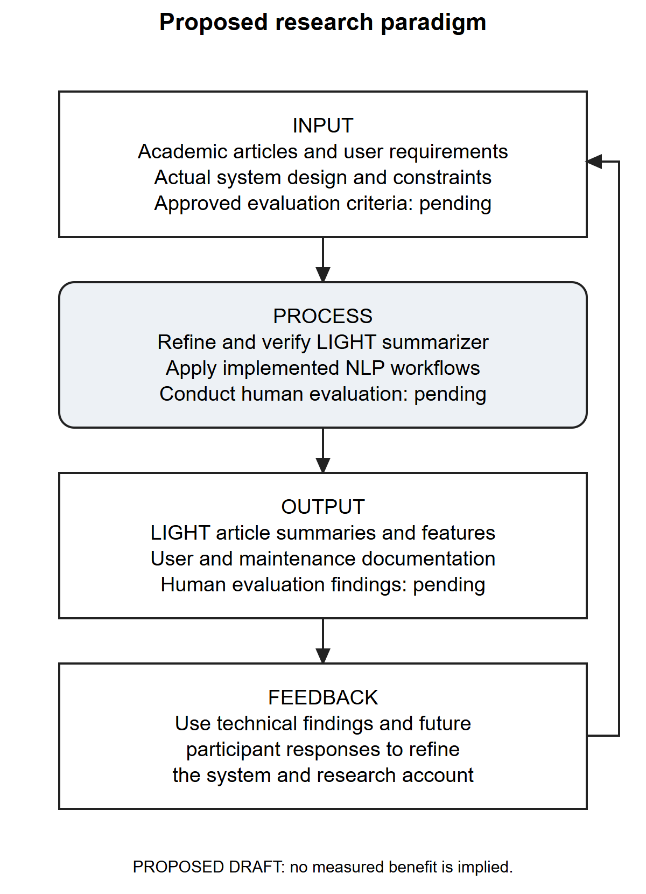

# CHAPTER I — THE PROBLEM AND ITS BACKGROUND

## Introduction

Academic reading requires more than reducing the number of words on a page. A useful summary must identify the central subject, retain important supporting information and preserve the source's qualifications. A shorter passage that changes a numerical result, omits a condition or attributes an assertion to the wrong entity may be easier to scan while being less useful for study. A summarization tool must consequently be examined both as a software application and as a system that transforms information.

The researcher-supplied project draft identifies lengthy academic articles, journals and other readings as the intended materials for LIGHT summarizer. It describes students of Nueva Ecija University of Science and Technology, Peñaranda Off-Campus, as the intended primary users and presents manual identification of important ideas, note-taking and repeated review as motivating concerns. These concerns are the researchers' stated rationale. No interview transcripts, needs-assessment dataset or observed time-and-motion study was supplied to establish their prevalence at the campus. The present manuscript treats them as a project motivation to be investigated, rather than as measured findings about the student population.

LIGHT summarizer brings article input, summary generation and supporting reading actions into a browser-based workflow. The inspected implementation accepts pasted text, article URLs and supported PDF/DOCX files. It provides analysis profiles, summary-depth choices and output formats, together with features for nutshell explanations, history, feedback, translation and audio. Registered users and guests have different ownership and retention contexts, while administrators have monitoring and account-management functions. These statements describe implemented pathways; availability and correctness still depend on configuration, source material and the limitations documented in Chapter III.

The project addresses two related questions. First, can the implemented software accept, process, store and present information with appropriate functional and access boundaries? Second, do the resulting summaries and interface support the intended reading tasks? Source inspection and isolated tests can answer parts of the first question. The second requires approved source material, a defined evaluation protocol and actual judgments or task observations. Treating these evidence types separately allows the manuscript to document existing work without inventing student experiences or beneficial outcomes.

## Review of Related Literature and Studies

### Extractive ranking and information selection

Mihalcea and Tarau (2004) introduced TextRank as an unsupervised graph-ranking approach to keyword and sentence extraction. Text units are represented through relationships, allowing their importance to depend on the surrounding graph. This provides a useful conceptual basis for a comparative extractive baseline: sentence selection can be studied without assuming that a generated paraphrase is necessary for every reading task. The original study does not establish the quality of LIGHT's implementation or its suitability for the intended campus. [TextRank study](https://aclanthology.org/W04-3252/).

The inspected software contains a broader set of processing choices than a single named ranking method. Its evaluation subsystem includes lead-N, TF-IDF and TextRank comparison paths as well as the proposed pipeline and optional hybrid generation. A fair comparison would hold the source documents and relevant length conditions constant and record the specific implementation and configuration. Merely listing multiple algorithms does not show that one produces better summaries. In this project, those comparisons remain an evaluation capability until a controlled run and its evidence are supplied.

### Automatic comparison with reference summaries

Lin (2004) described ROUGE as a family of automatic summary-comparison measures using overlap with reference summaries, including n-grams and longest common subsequences. Such measures provide reproducible observations about correspondence to chosen references. They require explicit reference provenance and scoring settings; overlap should not be treated as a complete reading-comprehension measure. [ROUGE study](https://aclanthology.org/W04-1013/).

For LIGHT, this literature supports storing reference versions and metric status separately from generated outputs. A missing reference or unavailable model should remain visible as missing evidence. A score of zero represents a computed result and is therefore different from a computation that could not be performed. The current evaluation design makes that distinction. The manuscript does not provide ROUGE scores because no approved research corpus and completed benchmark results were supplied for this study.

### Faithfulness and factuality

Maynez, Narayan, Bohnet and McDonald (2020) examined faithfulness in neural abstractive summarization and reported unsupported content in the systems they evaluated. Their analysis also considered the relationship between automatic measures and human judgments. The study supports examining whether a summary is grounded in its source instead of relying on fluency alone. Its reported model outcomes cannot be transferred to LIGHT or used to estimate this application's error rate. [Faithfulness and factuality study](https://aclanthology.org/2020.acl-main.173/).

The corresponding concern in LIGHT is preservation of source meaning throughout extraction, cleaning, selection and presentation. A faithful selection cannot be made from information removed incorrectly during preprocessing. Likewise, evidence labels are useful only when their text and locations remain aligned with the source. The technical audit therefore examines the pipeline before considering aggregate quality claims. Optional synthesis and factuality checks are described according to the configuration and evidence available; their presence in code is not a guarantee that every output is correct.

### Evaluation through complementary evidence

Fabbri and colleagues (2021) presented SummEval, combining automatic evaluation with expert and crowd-sourced judgments of summarization outputs. Their work highlights the need for explicit, comparable evaluation protocols and human evidence alongside automatic measures. For LIGHT, the relevant implication is methodological: system usability, source fidelity and automatic similarity should be reported as distinct observations. SummEval's datasets and results do not constitute an evaluation of this project. [SummEval study](https://aclanthology.org/2021.tacl-1.24/).

A user may find an interface convenient while overlooking an omitted qualification. A technical reviewer may identify an authorization defect without judging whether a summary is suitable for a particular lesson. The proposed protocol consequently separates application-quality questionnaires, source-based summary review and technical tests. The application's ordinary star-rating feedback is also distinct from a controlled study, since its exposure conditions, respondent eligibility and duplicate-response controls may differ from the research protocol.

### Product-quality framework and edition control

ISO/IEC 25010:2011 described an eight-characteristic product-quality model. ISO records that edition as withdrawn on 4 March 2024; the 2023 product-quality edition has nine characteristics. These edition differences matter when naming an evaluation framework. [ISO/IEC 25010:2011 record](https://www.iso.org/standard/35733.html); [ISO/IEC 25010:2023 record](https://www.iso.org/standard/78176.html).

To preserve the reference manuscript's organization, this draft proposes seven selected domains using the older template's vocabulary: functional suitability, performance efficiency, compatibility, usability, reliability, security and portability. Maintainability is omitted from that selected questionnaire. The items are original project-specific questions, not reproduced ISO clauses, and this selection is not a complete conformity assessment of either edition. The adviser must approve retention of the historical template or require revision to another framework before administration. Source-code maintainability can still be discussed through the technical audit without pretending that an omitted survey domain was measured.

### Synthesis and project contribution

The reviewed literature suggests that summary evaluation should consider information selection, reference correspondence and source faithfulness, while software assessment should address the conditions under which users obtain and interpret an output. These perspectives inform the proposed study rather than establishing its results. The bounded contribution documented here is the integration and examination of an existing application: its workflows, processing controls, storage model, interface, operational requirements and reproducible defects. A claim of algorithmic superiority, improved academic performance or campus-wide adoption would require additional evidence.

## Conceptual Framework

The proposed framework organizes the development and assessment of the intended reading tool. Inputs comprise supported articles and documents, researcher-supplied requirements, implemented source and schema, and the approved criteria needed for future evaluation. The process comprises system refinement, source extraction and NLP summarization, safe technical testing, and human evaluation once its prerequisites are satisfied. Expected outputs comprise summaries and supporting reading features, evidence-grounded system documentation, user and maintenance manuals, and future evaluation findings only when actual records are available. Technical findings and later participant feedback inform further refinement. These are proposed relationships and implemented processing stages, not proof of completed research activities, learning gains or automatic model retraining.

Figure 1. Proposed research paradigm for LIGHT summarizer.

The framework in Figure 1 organizes the study's intended inquiry. It does not assert a proven causal relationship between application use and learning. Software availability, source genre, extraction quality, chosen depth, browser/device conditions and model availability may influence the observed experience. A future effectiveness study would need to control or document these conditions and select an outcome measure that matches its claim.

## Statement of the Problem

This project concerns the implementation and assessment of LIGHT summarizer as a tool for handling lengthy written materials. The following questions are proposed for researcher and adviser approval; they have not been represented as a previously approved research protocol.

1. What reading and summarization needs should guide the use of LIGHT among the intended users, and which of those needs are supported by documented stakeholder evidence?
2. How does the implemented system acquire articles, generate and present summaries, manage user access and retain supporting records?
3. What functional, processing, security and reliability limitations can be established through source inspection, schema verification and isolated testing?
4. How would qualified technical evaluators assess the system under the seven selected application-quality domains after the required safeguards and evaluation conditions are established?
5. How would intended end users assess functional suitability, perceived performance and usability after completing approved representative tasks?
6. What improvements are warranted by the combined technical findings and, when available, independently collected human evaluation evidence?

The fourth and fifth questions remain unanswered in the absence of actual respondents and response records. They are included to complete the proposed study design, not to imply that a questionnaire has been administered.

## Objectives of the Study

The general objective is to document and assess LIGHT summarizer as an implemented article-processing application while establishing a defensible plan for evaluating its intended use.

The specific objectives are to identify source-supported requirements and outstanding stakeholder information; map actual roles, functions, data flows and storage; verify selected behaviors using controlled evidence; document known defects and operational constraints; prepare project-specific technical and end-user instruments for review; and derive recommendations whose strength is limited by the available evidence. Measuring learning improvement, comparative reading time or adoption is outside these objectives unless the researchers approve an additional study design with appropriate records.

## Scope and Delimitation

The technical scope covers the supplied PHP/Python application, its public interface files, configuration, checked-in database scripts, live schema metadata and operational utilities as examined on 17 October 2026. It includes guest and account contexts, main summarization, result actions, history and feedback, administrator features, document-combination caching and the separate evaluation subsystem. The database description uses the actual `summaries`, `summary_artifacts`, `feedback` and related tables; older draft labels such as `summary_records` and `feedback_records` are not actual schema entities.

The main pipeline supports eight analysis modes, six depth values and five output formats. The document-combination/evaluation path uses five lengths. These are interface or configuration options, not promises of exact sentence/word counts for every source. Extraction quality may depend on the document structure and available libraries. Scanned-document recognition, complex layout interpretation, translation quality and voice-model availability must not be assumed from file acceptance alone.

The audit preserved the application and production data. It used direct metadata queries and synthetic isolated checks; it did not conduct live destructive testing, read private database records or execute real account, email or cleanup workflows. A source-preserving interface rendering is not proof of authenticated database integration. Optional models were not treated as active merely because related code exists. Known access-control, installation, lifecycle and preprocessing defects delimit the conclusions.

The intended locale comes from the researcher draft. The population, sample size, recruitment method, actual study dates and institutional approvals remain to be confirmed. No real human response dataset, controlled educational experiment or verified production deployment was supplied. The manuscript therefore contains proposed research instruments and blank institutional forms, not fabricated evaluation tables or completion certificates.

## Significance of the Study

For intended student users, the project offers a means of organizing article input and accessing shorter views alongside supporting reading functions. Its potential value is assistance with review; improved comprehension, reduced workload and learning gains remain outcomes to be investigated. Users must still compare important assertions with the original material.

For instructors and researchers, a documented processing and evaluation workflow can help distinguish an output's convenience from its source fidelity. Versioned references and clearly stated review criteria could support future assessment if an approved corpus and protocol are established. They do not replace academic judgment or source citation.

For administrators and maintainers, the audit supplies an actual schema inventory, workflow descriptions, access-control limitations and operational procedures. This evidence can guide prioritization of corrective work and a safer deployment decision. For future developers, the preserved distinction between existing code, tested behavior and proposed activities provides a traceable starting point for implementation and research replication.

## Definition of Terms

**Analysis profile.** A selectable emphasis, such as general, academic or technical, passed to the summary-processing logic. A profile is not a separately trained model established by this audit.

**Article source.** The permitted text, URL content or supported uploaded document supplied for processing.

**Extractive summary.** A summary formed primarily by selecting information units from the source. In this manuscript, use of the term does not guarantee perfect preservation of context.

**Source faithfulness.** Agreement between an output's assertions and the information supported by its source, including conditions, entities and numerical details.

**Summary depth.** A requested level of detail. The main application's allowed values differ from those of the standalone combination/evaluation path.

**Nutshell.** The application's concise explanatory output feature, distinct from the persisted main-summary workflow.

**Guest context.** Access associated with a session-held guest token instead of a registered account; it is not a third database user role.

**Recoverable job.** A stored processing request with state, ownership and bounded recovery information that supports progress tracking and certain retry/cancel actions.

**Artifact.** Stored source or generated content associated with a summary record.

**Evaluator.** An eligible account assigned to review specified outputs. Assignment does not create a separate role value in `users.role`.

**Technical audit.** Examination of implementation evidence and selected controlled behavior. It is distinct from respondent opinion and from a completed penetration-test certification.

**Source-supported.** A statement present in supplied project material or inspected code whose broader historical or operational claim may still require verification.

**Pending evaluation.** A planned assessment for which actual response or measurement evidence has not been supplied.
