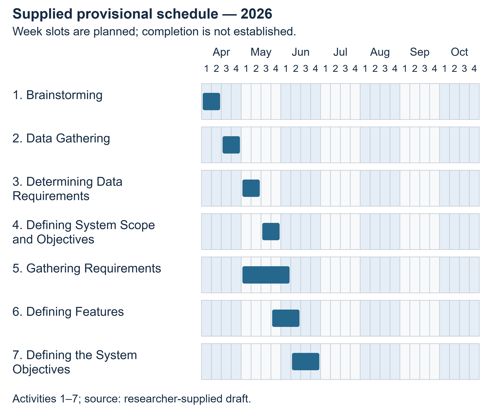
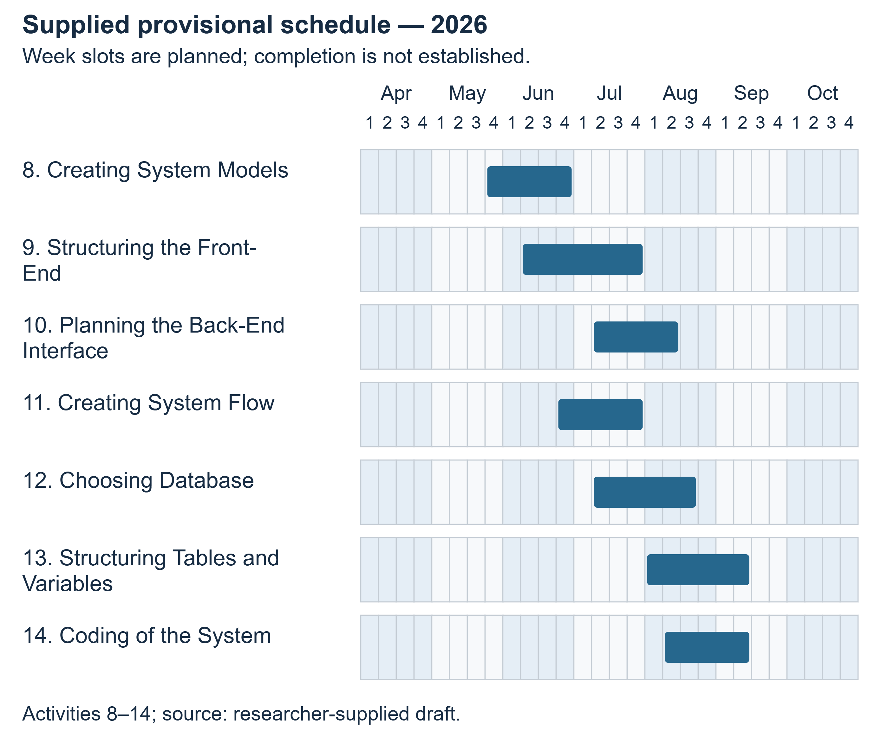
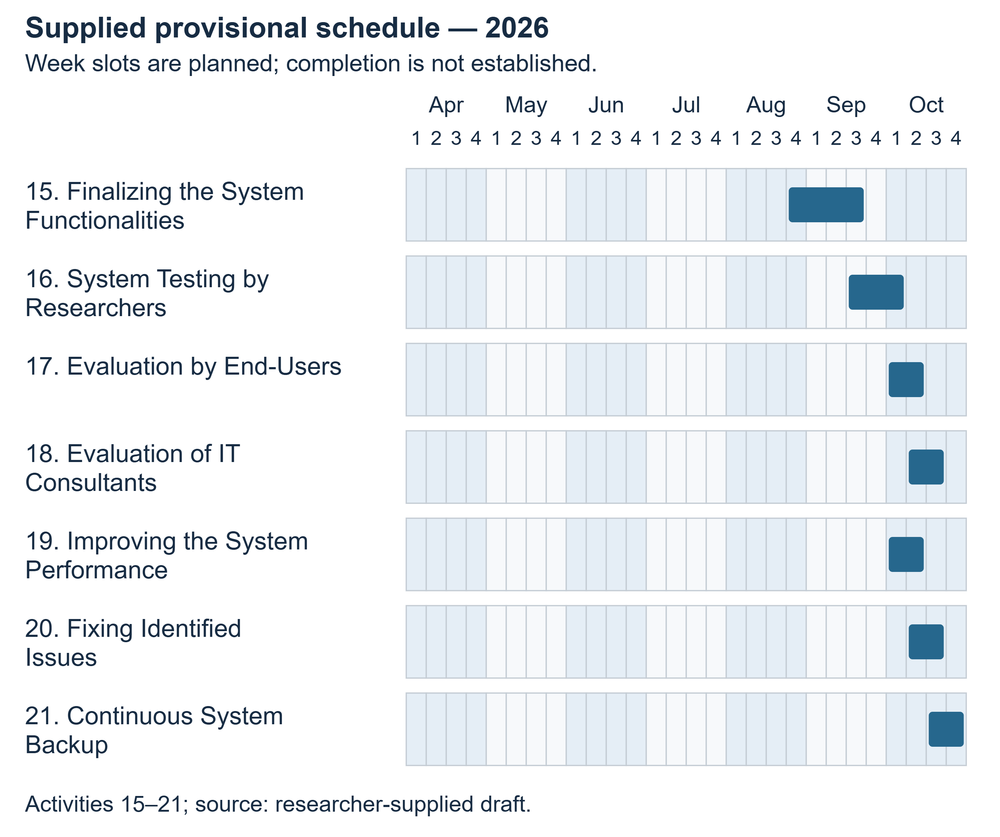

# CHAPTER II — METHODS AND PROCEDURES

## Research Design

This manuscript combines a documented examination of the existing software with a proposed descriptive evaluation of its intended use. The completed technical work concerns source structure, database metadata, controlled behavior and interface presentation. The proposed human component concerns technical reviewers' and intended users' assessments under stated tasks and conditions. These components answer different questions and require separate evidence. An automated test is not a respondent, a rendered page is not proof of a completed user session, and a service method is not proof that a research procedure occurred.

The researcher-supplied draft describes development through an Agile Development Life Cycle and includes a schedule spanning April to October 2026. This is a supplied account of the intended development approach. Dated sprint records, backlog revisions, review minutes, stakeholder consultations and acceptance records were not supplied. The manuscript can therefore describe the draft's stage organization and the implementation available for inspection, but cannot verify historical adherence to Agile practices or mark scheduled activities as completed.

The proposed assessment is descriptive rather than a controlled causal experiment. It is designed to report observed software behavior and judgments following representative tasks. It cannot establish that LIGHT improves examination scores, causes better comprehension or reduces reading time without an additional approved design, appropriate comparison conditions and actual measurements. The questions and instruments remain subject to adviser and institutional review.

Table 1. Research questions, evidence sources and limits of inference.

| Inquiry | Evidence or proposed method | Permitted interpretation |
|---|---|---|
| Intended needs | Researcher draft; future approved stakeholder inquiry | Draft motivation is known; prevalence and priority of needs remain unmeasured. |
| Implemented functions and storage | Source inspection, configuration, route mapping and read-only schema metadata | Describes observed implementation and constraints. |
| Functional and technical limitations | Isolated synthetic fixtures, automated tests and source-preserving interface examination | Establishes specific tested behavior under recorded conditions. |
| Technical reviewer assessment | Proposed Appendix H after approved staged tasks | Describes eligible reviewers' judgments; does not certify security or standard conformance. |
| End-user assessment | Proposed Appendix I after representative tasks | Describes participants' experience within the sample and conditions. |
| Improvements | Traceable synthesis of defects and future response evidence | Supports prioritized recommendations without inventing unobserved benefits. |

Table 1 links each inquiry to the evidence needed to answer it. The distinction prevents source inspection and synthetic tests from being presented as student or consultant responses. It also identifies the questions that remain open until an approved evaluation is completed.

## Development Approach Described in the Researcher Draft

### Planning and analysis

The supplied draft associates planning with identifying academic-reading concerns, defining scope and objectives, and selecting features such as adjustable summaries, nutshell output, Filipino translation, audio, history and feedback. Analysis is presented as the clarification of requirements and feature relationships. In the present documentation, these statements are reconciled with the available application. Features are described from their actual entry points, processing paths and storage rather than presumed from a planned diagram.

### Design

The draft includes use cases and data-flow diagrams, but some flows are incomplete or reversed and certain store names do not match the database. This manuscript uses diagrams derived from the audited source and actual schema. Guest, registered-user, administrator and assigned-evaluator contexts are distinguished where their permissions differ. The ERD shows actual foreign keys, while explanatory notes identify important logical links that are not enforced constraints. Reconstructing current design does not establish the chronological sequence in which the researchers originally normalized or implemented it.

### Implementation

Implementation is evidenced by the PHP application, Python engine, SQL definitions, assets and operational scripts supplied in the workspace. The main PHP workflow validates a request, records a processing job, invokes local processing, stores an output and serves result/history actions. The database and service layers also support document-combination caching, feedback and evaluation records. Optional processing branches are identified separately from configured defaults. Code and runtime configuration form the basis of the technical description; the older project's narrative does not override them.

### Testing, integration and maintenance

The supplied schedule includes researcher tests, end-user evaluation, consultant evaluation and maintenance activities. The technical audit provides its own dated isolated test evidence, which must not be retroactively represented as the researchers' historical tests. Likewise, source code for an evaluation system does not establish that an evaluation was conducted. Maintenance scripts and a worker monitor are implemented, while an automatic backup program and completed restore drill were not verified. Appendix G separates available operations from proposed practice.

### Supplied development schedule

The following table transcribes the 21 activities and colored intervals in the supplied Gantt image. Its four numbered slots per month do not specify calendar-day boundaries. The intervals are retained as provisional month/week labels, without invented dates or completion percentages. Confirmation is required whether this is an original plan, revised plan or as-completed record.

Table 2. Researcher-supplied provisional Gantt schedule, April–October 2026.

| No. | Stage | Activity | Supplied interval |
|---|---|---|---|
| 1 | Planning | Brainstorming | April weeks 1–2 |
| 2 | Planning | Data Gathering | April weeks 3–4 |
| 3 | Planning | Determining Data Requirements | May weeks 1–2 |
| 4 | Planning | Defining System Scope and Objectives | May weeks 3–4 |
| 5 | Analysis | Gathering Requirements | May week 1–June week 1 |
| 6 | Analysis | Defining Features | May week 4–June week 2 |
| 7 | Analysis | Defining the System Objectives | June weeks 2–4 |
| 8 | Design | Creating System Models | May week 4–June week 4 |
| 9 | Design | Structuring the Front-End | June week 2–July week 4 |
| 10 | Design | Planning the Back-End Interface | July week 2–August week 2 |
| 11 | Implementation | Creating System Flow | June week 4–July week 4 |
| 12 | Implementation | Choosing Database | July week 2–August week 3 |
| 13 | Implementation | Structuring Tables and Variables | August week 1–September week 2 |
| 14 | Implementation | Coding of the System | August week 2–September week 2 |
| 15 | Testing and integration | Finalizing the System Functionalities | August week 4–September week 3 |
| 16 | Testing and integration | System Testing by Researchers | September week 3–October week 1 |
| 17 | Testing and integration | Evaluation by End-Users | October weeks 1–2 |
| 18 | Testing and integration | Evaluation of IT Consultants | October weeks 2–3 |
| 19 | Maintenance | Improving the System Performance | October weeks 1–2 |
| 20 | Maintenance | Fixing Identified Issues | October weeks 2–3 |
| 21 | Maintenance | Continuous System Backup | October weeks 3–4 |

Table 2 is evidence of the researchers' supplied planning artifact. It is not evidence of respondent participation, actual consultant ratings, completed fixes or backup execution. Supporting records are listed in the research-information register.

Figure 2. Researcher-supplied provisional schedule, activities 1 to 7.

Figure 2 illustrates the supplied month and week slots for these activities. The chart is an original redraw of the researcher draft, not a record of completed work. No exact calendar dates, participant events or evaluation results are inferred from its shaded intervals.

Figure 3. Researcher-supplied provisional schedule, activities 8 to 14.

Figure 3 illustrates the supplied month and week slots for these activities. The chart is an original redraw of the researcher draft, not a record of completed work. No exact calendar dates, participant events or evaluation results are inferred from its shaded intervals.

Figure 4. Researcher-supplied provisional schedule, activities 15 to 21.

Figure 4 illustrates the supplied month and week slots for these activities. The chart is an original redraw of the researcher draft, not a record of completed work. No exact calendar dates, participant events or evaluation results are inferred from its shaded intervals.

## Technical Examination Procedure

The technical examination began with study of the full reference manuscript's structure and formatting, followed by inspection of the supplied application. Source files, routes, service responsibilities, dependencies and configuration were mapped before manuscript claims were drafted. The reference's institutional records, survey outcomes and project-specific statements were excluded from the LIGHT evidence base.

Database inspection used direct PDO queries for table, column, index, check and foreign-key metadata. It did not load the web bootstrap or retrieve user records. This distinction was necessary because ordinary application startup can touch guest records and occasionally purge expired data. The resulting snapshot verified 31 tables, 312 columns and 35 foreign keys. Comparison with the base schema and migrations identified differences between the configured database and a fresh-install definition.

Executable checks used isolated copies, synthetic text or files, and in-memory test storage where appropriate. The actual document controller/service was exercised against a synthetic SQLite database to test owner boundaries. Audio range handling used a synthetic file. The Python suite and selected smoke checks ran in an isolated environment with the recorded dependency and optional-model limitations. Interface capture used an isolated rendering arrangement whose scope is described in the UI audit. Production account actions, email transmission, cleanup, migrations and live content-processing requests were not performed.

Each reported technical result distinguishes expected behavior, observed behavior, status and evidence location. Source-supported capability and untested integration are labelled separately. The audit's failures are retained rather than excluded to create a favorable success rate. Chapter III reports the actual results; the method does not convert them into human usability ratings.

## Research Locale

The researcher draft identifies Nueva Ecija University of Science and Technology, Peñaranda Off-Campus, as the intended setting and identifies students as intended primary users. This is the supplied locale statement. The exact academic unit, program, study population, venue, contact official and permission reference remain [REQUIRES RESEARCHER CONFIRMATION]. No campus event, installation, demonstration or data-collection session is asserted.

The technical audit occurred in the supplied local Windows/XAMPP workspace. That computing environment is an implementation context, not evidence that the campus hosted the application. A campus photograph or location map should be inserted only from an authentic authorized source and labelled according to its actual purpose; none is fabricated here.

## Research Respondents

Two proposed groups address application quality from different perspectives. Technical reviewers should have relevant software-development, testing, deployment or information-systems experience sufficient for the tasks they are asked to judge. Intended end users should belong to the confirmed target population and have a legitimate need to read the selected materials. The institution must approve eligibility, recruitment and any age-related consent requirements before participation.

Table 3. Proposed respondent groups and outstanding sampling information.

| Group | Proposed role in the study | Target number | Actual valid responses |
|---|---|---|---|
| IT consultants or qualified technical reviewers | Review seven selected application-quality domains using staged evidence and tasks | REQUIRES APPROVAL | NOT PROVIDED |
| Intended student/end-user group | Review functional suitability, perceived performance and usability after tasks | REQUIRES APPROVAL | NOT PROVIDED |

Table 3 keeps the two proposed groups separate and leaves their numbers unresolved. The groups must not be combined into an invented total. The number of researchers is not the sample size. Application accounts, feedback rows, test cases and browser screenshots are not substitute respondent counts. No demographic distribution or response rate is computed in this draft.

## Sampling Procedure

Purposive selection of technically qualified reviewers is proposed because the instrument requires relevant competence. For end users, the researchers should first obtain the eligible population frame and choose an institution-approved recruitment method that matches the desired scope of inference. If practical recruitment uses a nonprobability volunteer sample, the resulting limitations must be stated; its findings must not be presented as statistically representative of all campus students.

No numerical sample-size formula is applied without a population, target precision, design assumptions and actual recruitment plan. The researchers must document invitations, eligibility checks, refusals/withdrawals and usable responses without publishing unnecessary identifiers. Participation should be voluntary and should not affect grades or access to ordinary services. The final sampling procedure must describe what actually happened, including deviations from the plan.

## Research Instruments

Appendix H contains 28 proposed technical-review items: four each for functional suitability, performance efficiency, compatibility, usability, reliability, security and portability. Appendix I contains 12 proposed end-user items: four each for functional suitability, perceived performance and usability. These are original project-specific items organized using selected domains from the older reference template. Maintainability is excluded, so the seven-domain questionnaire is not the complete ISO/IEC 25010:2011 model. The withdrawn 2011 edition and revised 2023 edition must not be conflated. [Official 2011 record](https://www.iso.org/standard/35733.html); [official 2023 record](https://www.iso.org/standard/78176.html).

Both proposed questionnaires use the same four-point agreement scale, with a separate not-observed/not-applicable response. The application itself has ordinary 1–5 feedback and a separate 1–5 blind-summary rubric. Those built-in records are different instruments and must not be merged numerically with the proposed four-point questionnaires. Source-fidelity review, if undertaken through the evaluation module, requires its own corpus, rubric, evaluator training and analysis specification.

Table 4. Proposed questionnaire response coding.

| Response | Numeric value | Meaning |
|---|---|---|
| Strongly Disagree | 1 | The statement clearly does not describe the observed experience/evidence. |
| Disagree | 2 | The statement generally does not describe the observed experience/evidence. |
| Agree | 3 | The statement generally describes the observed experience/evidence. |
| Strongly Agree | 4 | The statement clearly describes the observed experience/evidence. |
| Not observed / Not applicable | No numeric value | The respondent lacks the required exposure or the item does not apply; reason requested. |

Table 4 assigns numeric values only to observed agreement responses. An observed failure should receive an appropriate disagreement response and an explanatory note, not be removed as “not applicable.” Unobserved security or recovery properties should not be guessed. Questionnaire review and pilot testing are proposed before use; no content-validity score, reliability coefficient or pilot outcome is supplied. Item revisions should be versioned and completed before final collection.

## Proposed Data-Gathering Procedure

First, the researchers should finalize the study questions, eligibility criteria, source-material permissions, privacy arrangements and instruments with the adviser. They should obtain the appropriate institutional approval and participant information/consent materials before recruitment. Copies or references belong in the supporting appendices. This draft's blank letters are not evidence of approval.

Second, the researchers should address the known access-control and processing defects or establish a reviewed restricted evaluation environment. The environment must use staging-controlled accounts and permitted nonconfidential documents. Record the code version, engine setting, model availability, browser, device and network conditions. A successful demonstration must not be inferred from a screenshot or planned agenda.

Third, participants should receive consistent task instructions without suggestions about desired ratings. Representative tasks may include submitting a prepared text, changing depth/format, comparing the output with the source, locating history, trying a supported file, and using available reading actions. Failed or unavailable actions must be recorded as such. Technical reviewers may additionally inspect staged ownership denials, errors, installation and recovery evidence; real private records must not be exposed for evaluation.

Fourth, each respondent should complete the approved questionnaire independently, using a study code instead of unnecessary personal identifiers. Record which tasks were attempted and whether help was required. A separate optional comment field can capture specific difficulties. Store consent/identity linkage apart from coded responses, with an approved access and retention arrangement. Record actual collection dates and deviations.

Finally, the researchers should validate the response file for duplicate codes, out-of-range values, omissions and documented withdrawals. Keep the raw responses protected and maintain a reproducible analysis copy with a codebook. Present unresolved missing data and negative findings. Institutional closure, participant communication and final retention/disposal should follow the approved protocol. None of these human-collection steps is represented as completed in this manuscript.

## Data Analysis Technique

### Technical findings

Technical cases are classified as passed, failed, skipped, blocked or not tested according to recorded execution. The denominator for a pass rate must state whether skipped or unexecuted cases are excluded. Source-only observations are not added to executed-case totals. Findings are grouped by workflow and consequence, with reproduction/evidence references. Timings, if reported, must identify hardware, input, operation and repetition; configured timeout values are not observed latency.

### Questionnaire responses

For item j, let f1j, f2j, f3j and f4j denote the valid response frequencies at values 1 through 4. Let n_j = f1j + f2j + f3j + f4j. The proposed descriptive weighted mean is:

WM_j = (1f1j + 2f2j + 3f3j + 4f4j) / n_j.

If n_j is zero, report “not estimable,” not zero. Blank, withdrawn and not-observed responses are excluded from the numeric denominator and reported separately. The weighted mean is a descriptive convention for the ordered response scale, not proof that the underlying intervals are equal or that a quality standard has been satisfied. Frequencies and valid counts should accompany it; medians may be included to make the ordinal distribution visible.

For a domain with four items, the proposed respondent-level domain score is the arithmetic mean of answered items only when at least three have valid numeric responses. Report the number of qualifying respondents. A group domain mean averages those respondent-level scores, giving each qualifying respondent equal weight. If an overall summary is approved, average available domain means with equal domain weights only when every required domain has an estimable mean, and disclose differing respondent coverage. Keep technical and end-user groups separate.

Table 5. Proposed descriptive interpretation intervals for questionnaire means.

| Unrounded mean interval | Interpretation |
|---|---|
| 1.00 to 1.75 inclusive | Strongly Disagree |
| Greater than 1.75 to 2.50 inclusive | Disagree |
| Greater than 2.50 to 3.25 inclusive | Agree |
| Greater than 3.25 to 4.00 inclusive | Strongly Agree |

Table 5 provides nonoverlapping descriptive intervals. Apply the interval before rounding for display so boundary values are not reassigned by formatting. These labels are proposed analysis conventions, not ISO-prescribed acceptance thresholds. An “Agree” result cannot override a reproduced authorization failure or establish actual confidentiality. No means or interpretations are calculated until genuine response data exist.

### Summary quality and comments

Any later source-based evaluation should preserve reference provenance, document split, profile/depth, system version and metric implementation. Report automatic scores separately from human criteria and include failures/missing measures. The reviewed evaluation literature motivates this separation but does not supply LIGHT's outcomes. Comments may be organized into transparent descriptive themes with supporting de-identified examples; report how coding was performed and avoid identifying participants through quotations. No inferential significance test or effectiveness claim is proposed without a suitable design and dataset.

## Ethical and Methodological Boundaries

The study must use permitted source materials, voluntary participation and approved handling of personal information. Translation or optional remote processing can create additional data-transfer considerations that should be disclosed before use. The technical audit's synthetic fixtures avoid substituting real private records for test content. The manuscript preserves failures, unsupported historical claims and missing evidence explicitly. Final conclusions must reflect the actual approved protocol and collected data, including any limitations that remain after corrective work.
