# Focused ERD panels

SOURCE-SUPPORTED: these panels are exact subsets of the audited full ERD. The union contains every one of the 31 entities and 35 declared foreign-key relationships. Shared entities repeat to make the panels understandable. Only primary/foreign-key fields are shown; the data dictionary supplies all attributes. The unconnected-store panel deliberately has no relationship lines.

Full SVG overviews remain available for zooming; the focused panels are suitable for insertion on separate manuscript pages. The build coverage report programmatically checks that no declared entity or foreign key is omitted.

## Accounts and authentication

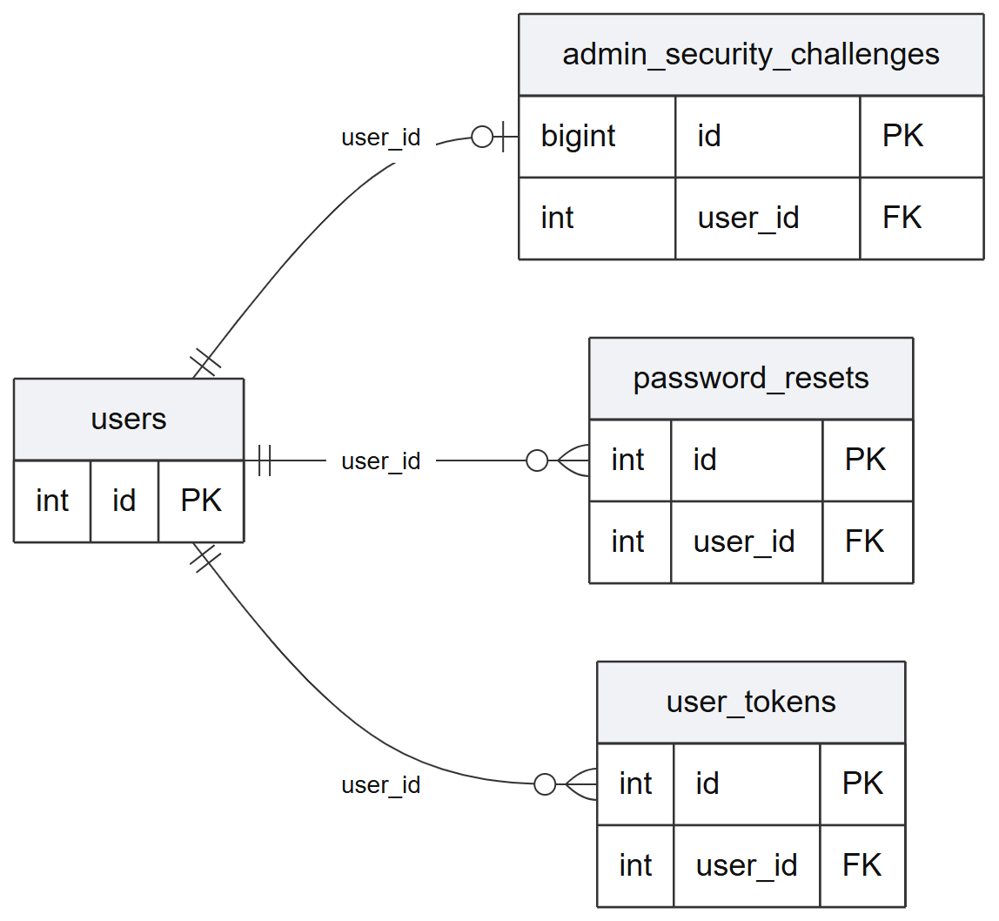

Editable source: [ERD_PANEL_01_ACCOUNTS.mmd](ERD_PANEL_01_ACCOUNTS.mmd). Vector version: [ERD_PANEL_01_ACCOUNTS.svg](ERD_PANEL_01_ACCOUNTS.svg).

## Summary ownership, jobs and generated artifacts

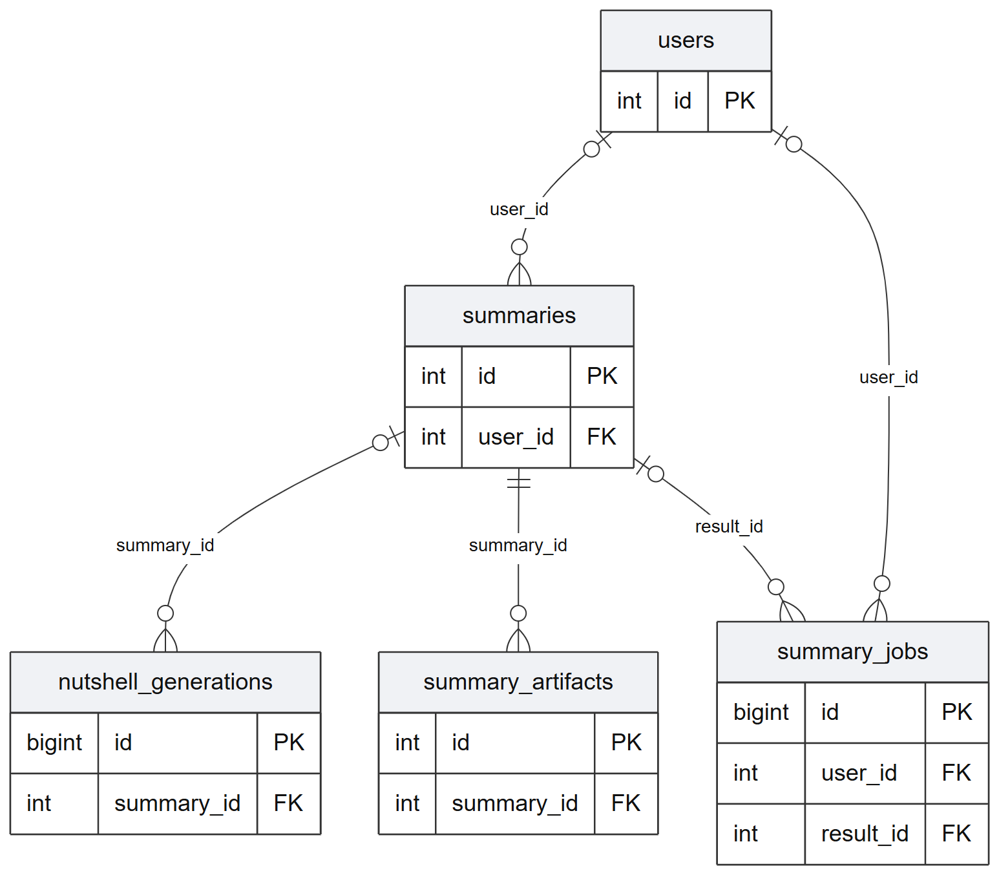

Editable source: [ERD_PANEL_02_SUMMARY_OUTPUTS.mmd](ERD_PANEL_02_SUMMARY_OUTPUTS.mmd). Vector version: [ERD_PANEL_02_SUMMARY_OUTPUTS.svg](ERD_PANEL_02_SUMMARY_OUTPUTS.svg).

## Summary ratings and comments

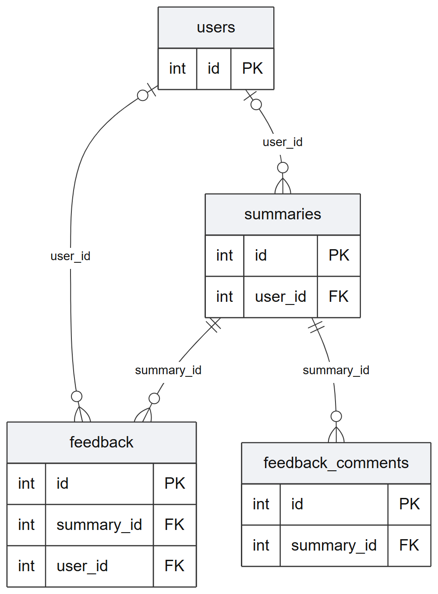

Editable source: [ERD_PANEL_03_FEEDBACK.mmd](ERD_PANEL_03_FEEDBACK.mmd). Vector version: [ERD_PANEL_03_FEEDBACK.svg](ERD_PANEL_03_FEEDBACK.svg).

## Document extraction and cached summaries

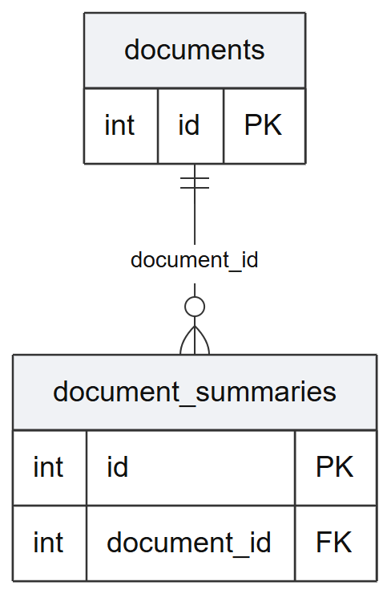

Editable source: [ERD_PANEL_04_DOCUMENT_CACHE.mmd](ERD_PANEL_04_DOCUMENT_CACHE.mmd). Vector version: [ERD_PANEL_04_DOCUMENT_CACHE.svg](ERD_PANEL_04_DOCUMENT_CACHE.svg).

## Landing-page sessions and events

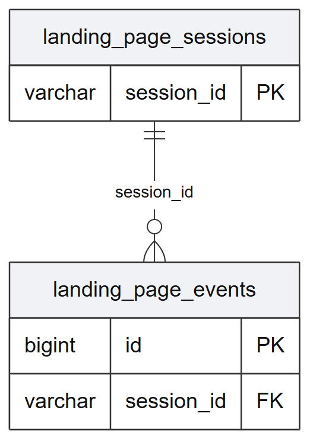

Editable source: [ERD_PANEL_05_LANDING_TELEMETRY.mmd](ERD_PANEL_05_LANDING_TELEMETRY.mmd). Vector version: [ERD_PANEL_05_LANDING_TELEMETRY.svg](ERD_PANEL_05_LANDING_TELEMETRY.svg).

## Tables without declared foreign-key relationships

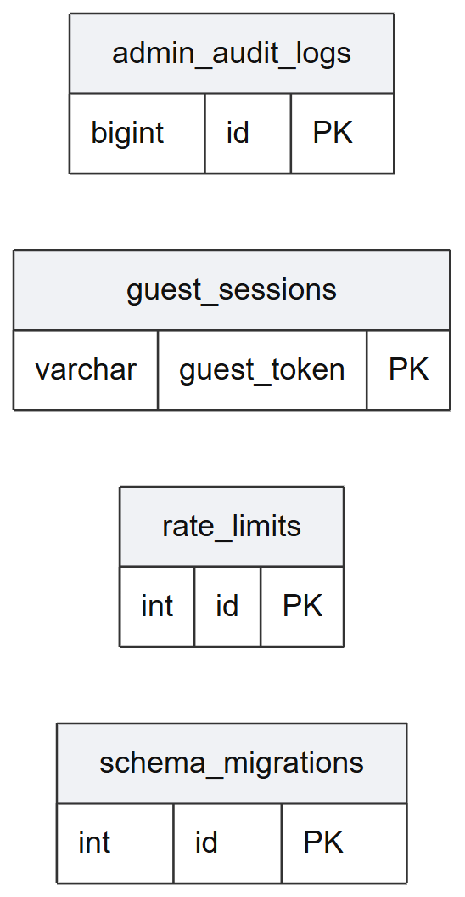

Editable source: [ERD_PANEL_06_INDEPENDENT_STORES.mmd](ERD_PANEL_06_INDEPENDENT_STORES.mmd). Vector version: [ERD_PANEL_06_INDEPENDENT_STORES.svg](ERD_PANEL_06_INDEPENDENT_STORES.svg).

## Evaluation datasets, documents, runs and outputs

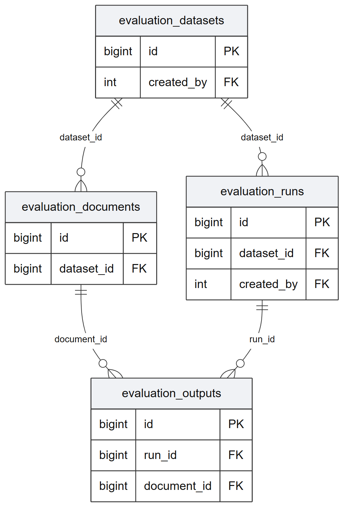

Editable source: [ERD_PANEL_07_EVALUATION_PIPELINE.mmd](ERD_PANEL_07_EVALUATION_PIPELINE.mmd). Vector version: [ERD_PANEL_07_EVALUATION_PIPELINE.svg](ERD_PANEL_07_EVALUATION_PIPELINE.svg).

## Evaluation content units, references and challenge cases

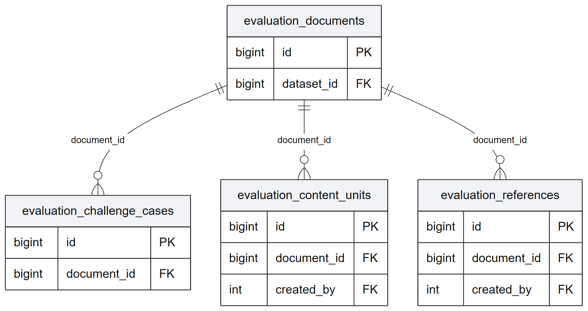

Editable source: [ERD_PANEL_08_EVALUATION_CONTENT.mmd](ERD_PANEL_08_EVALUATION_CONTENT.mmd). Vector version: [ERD_PANEL_08_EVALUATION_CONTENT.svg](ERD_PANEL_08_EVALUATION_CONTENT.svg).

## Evaluation assignments, ratings, errors and metrics

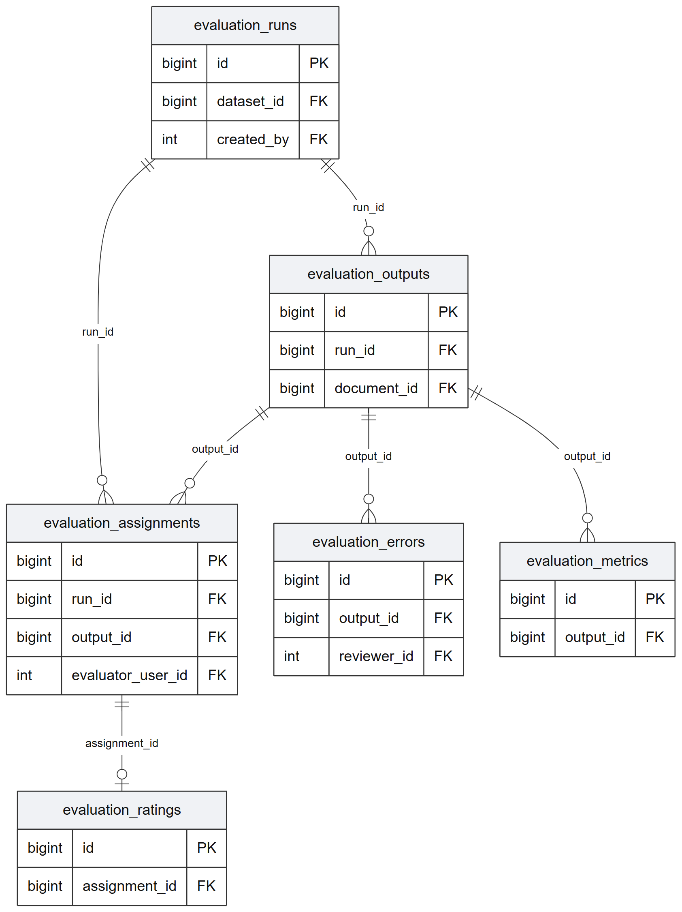

Editable source: [ERD_PANEL_09_EVALUATION_SCORING.mmd](ERD_PANEL_09_EVALUATION_SCORING.mmd). Vector version: [ERD_PANEL_09_EVALUATION_SCORING.svg](ERD_PANEL_09_EVALUATION_SCORING.svg).

## Content-unit reviews against generated outputs

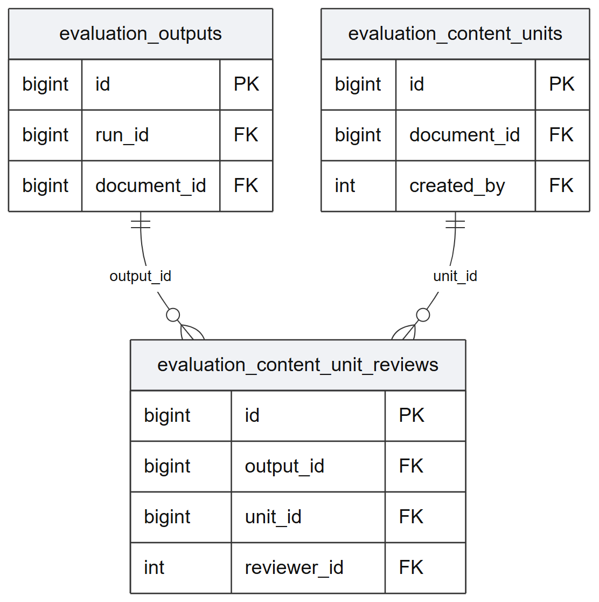

Editable source: [ERD_PANEL_10_UNIT_REVIEWS.mmd](ERD_PANEL_10_UNIT_REVIEWS.mmd). Vector version: [ERD_PANEL_10_UNIT_REVIEWS.svg](ERD_PANEL_10_UNIT_REVIEWS.svg).

## Evaluator, reviewer and audit actor account links

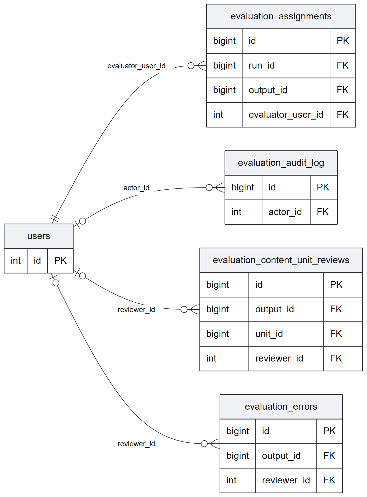

Editable source: [ERD_PANEL_11_EVALUATOR_ACCOUNTS.mmd](ERD_PANEL_11_EVALUATOR_ACCOUNTS.mmd). Vector version: [ERD_PANEL_11_EVALUATOR_ACCOUNTS.svg](ERD_PANEL_11_EVALUATOR_ACCOUNTS.svg).

## Research dataset, run and reference authorship

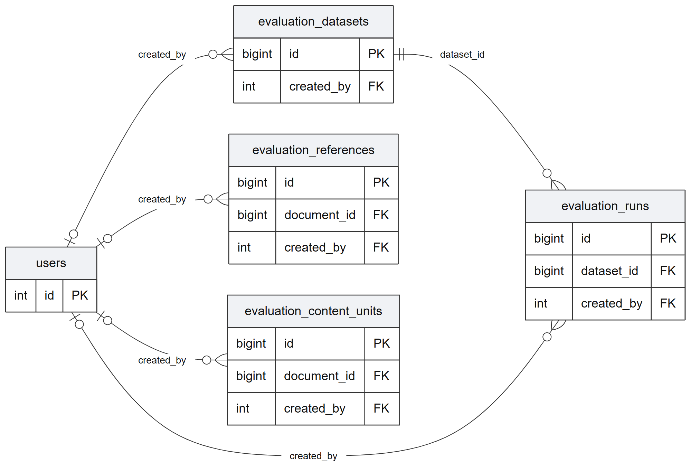

Editable source: [ERD_PANEL_12_RESEARCH_AUTHORSHIP.mmd](ERD_PANEL_12_RESEARCH_AUTHORSHIP.mmd). Vector version: [ERD_PANEL_12_RESEARCH_AUTHORSHIP.svg](ERD_PANEL_12_RESEARCH_AUTHORSHIP.svg).
