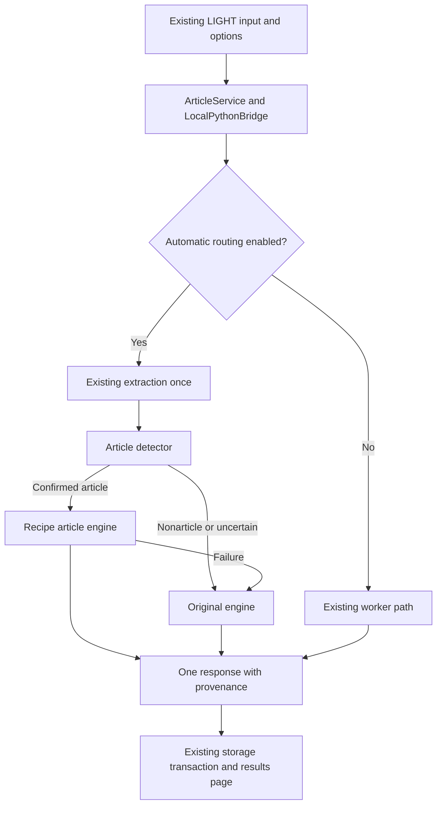

# Automatic routing and rollback

## Runtime repair and refinement status

Routing policy and detector code are unchanged. The current engine is experimental `recipe-article-2.1`; global default routing remains false. Independent quality and memory gates remain outstanding in [article-engine-release-readiness.md](article-engine-release-readiness.md).

Detached PHP jobs now carry a server-derived `--database-driver=mysql|pgsql` argument so an Apache process using MySQL cannot accidentally hand a job to a PostgreSQL-selecting CLI process. The selector is CLI-only, validated and cannot be supplied by the public form. A pinned PostgreSQL job fails closed if its accepting backend is unavailable. No database migration, endpoint replacement, production branch creation or Apache restart was performed. Existing schema/query compatibility beyond this local handoff is not newly certified.

Private `request-diagnostics.jsonl` records correlate the public error reference with job/request identity, stage, module/function, exception class, duration, selected engine and actual subprocess exit status where one exists. Constant-name Python stage traces identify long-running work without source text or queries. Daemon transport has no Python subprocess exit status to invent. Diagnostic storage is behind the existing storage denial rules; errors keep their friendly catalog responses.

The local `.env` timeout was raised from 180 to the existing 300-second bridge ceiling after real large-PDF timeouts; `NLTK_DATA` now identifies the already installed resources for service-account execution. Deployment defaults and the article flag were not enabled. Python's dotenv loader now preserves server-owned environment settings. Standard empty summaries remain invalid; only the strictly recognized unsupported-article-Focus informational contract can contain empty evidence.

The safest hook is `local_cli.handle_summarize`, used by both the existing JSON CLI and warm supervisor. PHP still calls `ArticleService.requestSummary` and `LocalPythonBridge.summarize`; the bridge attaches a server-owned boolean feature flag to each request so the daemon and subprocess receive the same setting. Raw form fields cannot override it.



`SUMMARIZER_AUTO_ARTICLE_ROUTING=false` is the default in `.env.example`, `Dockerfile`, and `render.yaml`. The private `.env` was not changed. Enabling it routes confident articles to the candidate and other content to **legacy**. When enabled, this router takes precedence over the optional `SUMMARIZER_ENGINE_VERSION=v2` selector. With the flag disabled, the existing legacy/v2 selection works as before. Requests explicitly opting into an existing synthesis path stay with the original path; the article engine never calls a generative API.

`SummarizationRequest.source_document` is an optional integration field. The existing pipeline accepts that object in place of calling its extractor again. This avoids repeating PDF/DOCX work during detection or fallback and preserves page/source metadata. Its default is `None`, which executes the original extraction call. Ranking, cleaning, selection, validation, and formatting algorithms of the original engine were not changed by this update.

The router completes entirely inside the worker, before the existing PHP persistence transaction. One original-engine fallback produces one result; it cannot independently create a history row, analytics event, or second job. Extraction failures retain their typed errors and do not trigger a meaningless second extraction. Bad article contracts or unavailable article modules invoke one original-engine attempt. If that also fails, the existing error response remains authoritative. Existing supervisor deadlines bound the entire operation, including fallback; no new unbounded retry is introduced.

`source_metadata.engine_routing` records enabled status, actual selected engine, reason, fallback status, safe exception class, and structured detection. PHP's source metadata normalizer explicitly preserves these fields. A separate `article_analysis` subset preserves focus/annotation status and keywords. The router does not log document text, queries, filesystem paths, or exception messages.

## Enable for an isolated evaluation

Set `SUMMARIZER_AUTO_ARTICLE_ROUTING=true` in a staging environment and restart the normal worker/service after deploying the new code. Do not enable globally solely because execution tests pass: the retained comparison shows lower detail coverage for the article candidate.

Run the isolated PHP bridge probe with an explicit working interpreter:

```powershell
php scripts/test_article_routing.php all .\.venv-nlp\Scripts\python.exe
```

The probe uses a closed worker port to force subprocess transport and never opens a database connection. A real spawned supervisor test also verifies an enabled article request followed by a disabled request in the same warm child. The existing supervisor suite covers lifecycle/deadline behavior separately. Live authentication, history, admin, and deployed browser workflows are not established by these probes.

## Rollback

Set `SUMMARIZER_AUTO_ARTICLE_ROUTING=false`; retain the preexisting `SUMMARIZER_ENGINE_VERSION` value. The bridge sends the disabled value on subsequent requests, including requests to an already running updated daemon. New requests bypass detection and the candidate and use the original engine selection. Existing saved summaries retain their recorded provenance. No migration, history deletion, source move, or frontend rollback is needed.

## Change manifest

Modified integration/configuration files:

- `.env.example`
- `Dockerfile`
- `render.yaml`
- `app/config/config.php`
- `app/src/Services/ArticleService.php`
- `app/src/Services/LocalPythonBridge.php`
- `python-engine/local_cli.py`
- `python-engine/summarizer_core/models.py`
- `python-engine/summarizer_core/pipeline.py`

New implementation/evaluation files:

- `python-engine/article_detector.py`
- `python-engine/summary_engine_router.py`
- `python-engine/article_engine/__init__.py`
- `python-engine/article_engine/preprocessing.py`
- `python-engine/article_engine/baseline.py`
- `python-engine/article_engine/ranking.py`
- `python-engine/article_engine/summarizer.py`
- `python-engine/article_engine/detection_calibration.json`
- `python-engine/evaluation/article_routing_fixtures.py`
- `python-engine/evaluation/article_engine_experiment.py`
- `python-engine/tests/test_article_routing.py`
- `scripts/test_article_routing.php`

New research artifacts are the six Markdown documents in `docs/research/` and `article-engine-results.json`. Existing uncommitted UI/password, cleaning, cleanup, and manuscript work predates this update and was preserved.
